# Web Doctor

**Find a website problem, see it on the real page, fix it, and prove the fix worked.**

Web Doctor crawls a site in a real browser (Playwright, desktop and mobile), reports accessibility,
link, SEO, navigation and runtime problems with the offending element outlined on a screenshot,
re-checks a single issue after you fix it, and diffs every scan against the previous one. It runs
locally, in CI, or as a public scanner that strangers can use without being able to reach your
private network. It also exports a Markdown task for an AI coding agent.

<p align="center">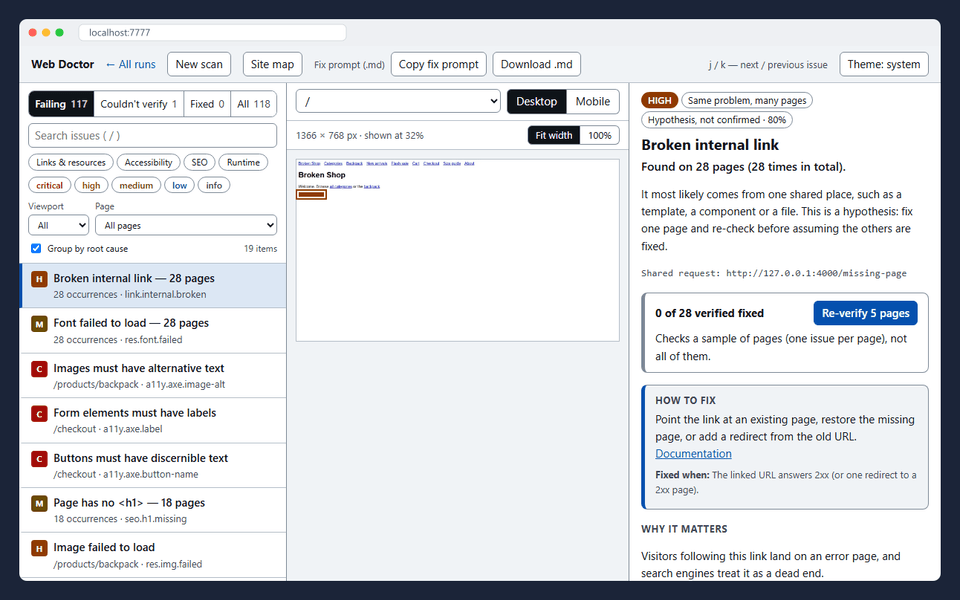</p>

<p align="center"><sub>The bundled demo site "Broken Shop": 28 pages, scanned at desktop and mobile size (56 page snapshots), collapsed into 4 root-cause groups.</sub></p>

## What makes it different

- **It does not lie about "fixed".** Scans of one site are compared by issue fingerprint into
  _New / Open / Fixed / Reopened / Not rechecked_. A problem that is merely absent from the new scan
  is only _Fixed_ if its page was scanned again in every viewport it was seen in; otherwise it stays
  _Not rechecked_. A smaller sample, a page that is down or a disabled category can never look like
  a clean bill of health, so `--new-only` in CI is trustworthy. [Details](#design-decisions)
- **Safe to expose to the internet.** `webdoctor serve` refuses loopback, LAN, cloud-metadata and
  Docker-network targets with one policy applied to every connection (pinned DNS, guarded `fetch`,
  a forced proxy for Chromium). It is proven by a real-Chromium test where a hostile page tries to
  reach an internal server and, as a control, succeeds when the guard is removed. Threat model:
  [docs/security.md](docs/security.md).
- **Honest about uncertainty.** Every issue has a severity _and_ a confidence, and a verdict of
  `fail` or `unverified` with a reason. An external link answering 429 is "couldn't verify", never
  "broken"; link-structure findings on a partial scan are tentative.
- **A fix prompt that cannot be hijacked.** `fix-prompt.md` is a task for an AI agent. Text copied
  from the scanned site is fenced as data, so a hostile page cannot instruct your agent. Calibrated
  on a real 50-page production site, grouping axe findings per rule and page shrank the prompt from
  4427 issues / 477 KB to 688 issues / 26 KB (see `git show 5b308a4`).
- **Tested like a product.** 468 tests in 44 files. A full end-to-end scan of the demo site must find
  its documented defects (`expected-issues.json`, 20 in broken mode) with at least 90% recall and
  nothing unexpected. The inspector audits itself with axe (WCAG A/AA, light and dark, 375 px) and
  fails on critical or serious findings.

## Try it in a minute

Needs Node 22+ and pnpm. The first run downloads Chromium.

```bash
pnpm install
pnpm --filter @webdoctor/scanner exec playwright install chromium
pnpm --filter @webdoctor/web build

pnpm demo &                                   # Broken Shop, a site with deliberate defects, on :4000
pnpm webdoctor scan http://127.0.0.1:4000     # crawl both viewports, write reports to .webdoctor/
pnpm webdoctor ui                             # open the printed link (it contains the access token)
```

In the inspector: pick an issue, press **Re-verify**; `curl -X POST http://127.0.0.1:4000/__demo/mode/fixed`
switches the demo site to its fixed state, so re-verify turns issues into _Verified fixed_.

## Tour

**Fix it, press Re-verify, get a verdict.** The demo site is switched to its fixed state and the one
problem is re-checked in a real browser: _Verified fixed_, with the result kept in the run.

<p align="center"></p>

**Regression Radar.** Three scans of the same site: broken, fixed (-117), broken again (117 came back as
_Reopened_, not _New_). Each run shows what changed since the previous one.

<p align="center">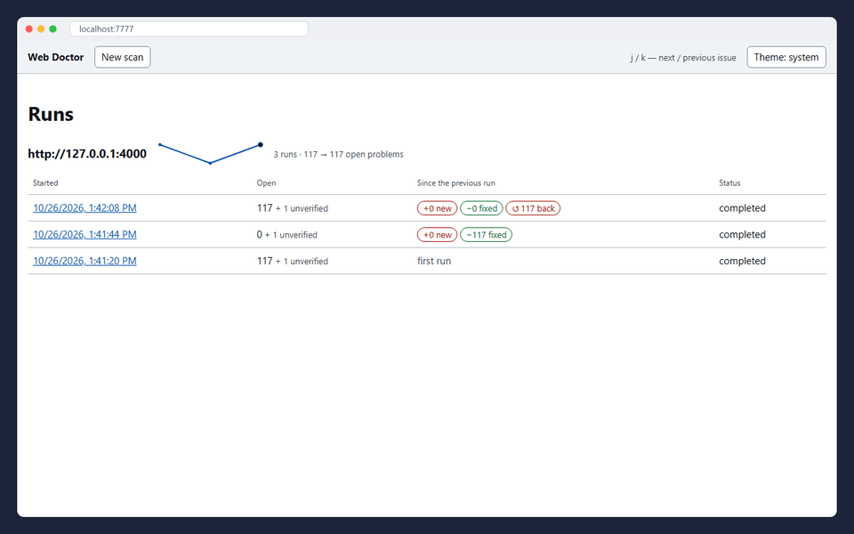</p>

**A public server that refuses private targets.** Cloud metadata, a non-web port on localhost and a LAN
address are rejected with a clear message before anything is fetched; the allow-listed demo site is
scanned normally.

<p align="center">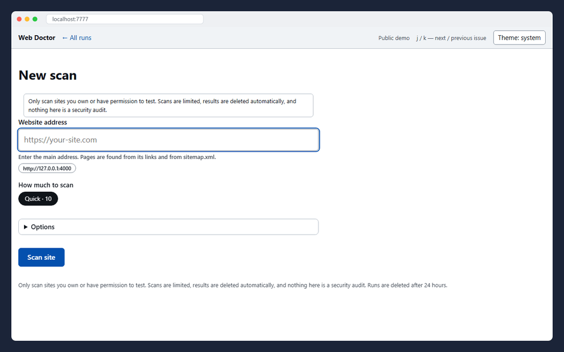</p>

**Scan from the browser.** Paste an address and watch the scan (a timelapse: the demo scan takes under a
minute), then open the results.

<p align="center">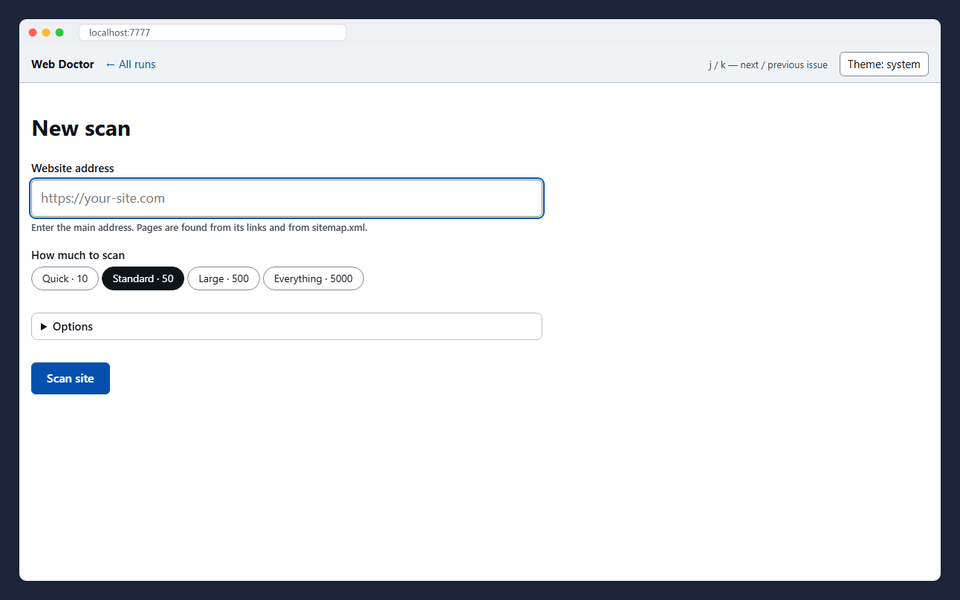</p>

## Screenshots

|                                                                                                                   |                                                                                              |
| ----------------------------------------------------------------------------------------------------------------- | -------------------------------------------------------------------------------------------- |
| 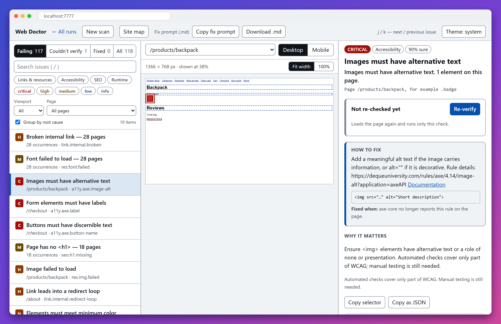                              | 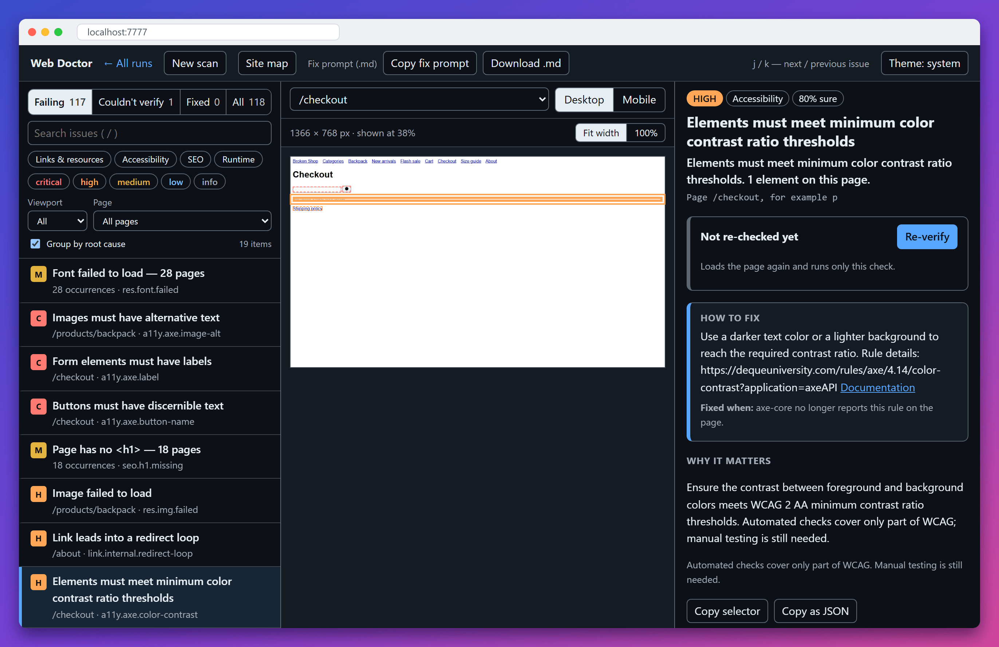                                               |
| **Findings are shown on the real page**, with a "fixed when" condition and a Re-verify button.                    | **Light and dark themes**, keyboard-first (`j`/`k`, `/`).                                    |
| 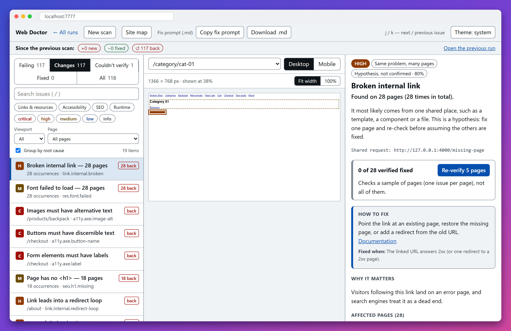     | 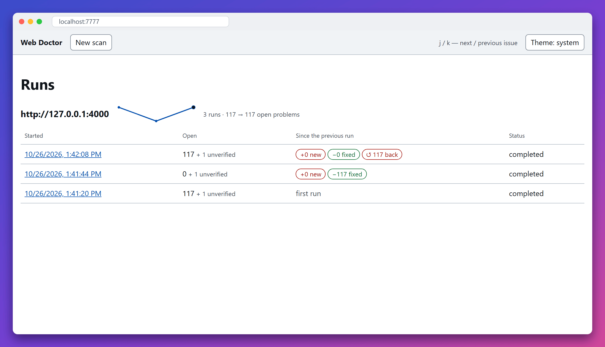                             |
| **Changes since the previous scan**: "117 back" and a "back" tag on each reopened problem.                        | **History per site**: trend, open problems and what changed in every run.                    |
| 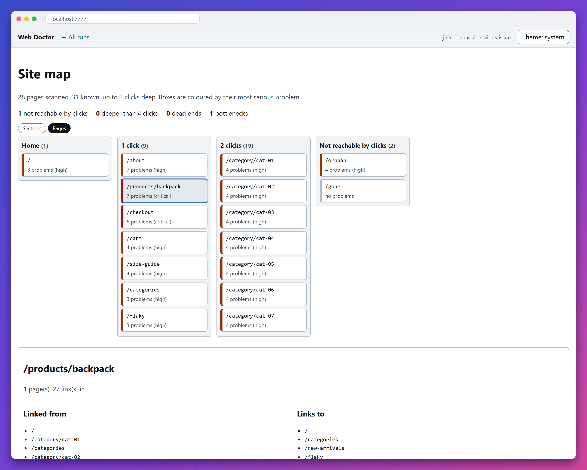                                                    | 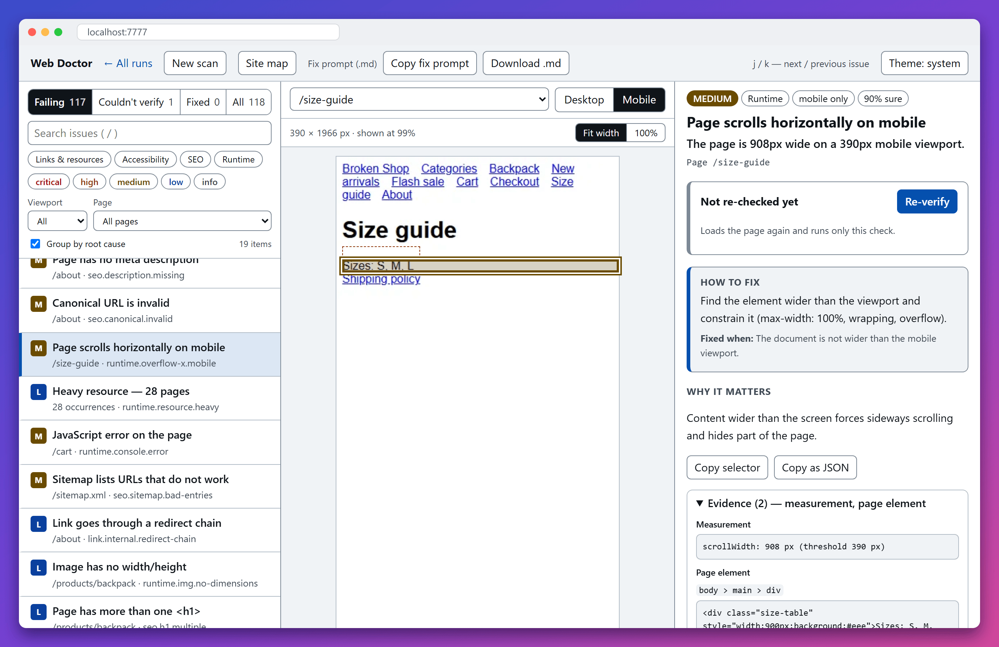                                     |
| **Site map**: pages by clicks from home, coloured by worst problem; pages no link leads to are listed separately. | **Mobile viewport**: a mobile-only horizontal overflow with the measurement and the element. |

<sub>All images are generated from the real product by `pnpm docs:capture` (it scans the demo site and drives the inspector with Playwright).</sub>

## How it works

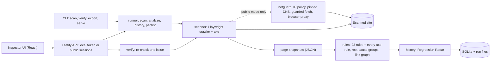

1. **Crawl** (`packages/scanner`): breadth-first from the start page, seeded from `sitemap.xml`
   (indexes expanded, sampled across templates and languages when it does not fit). Each page is
   loaded per viewport; the scanner stores a screenshot, the DOM facts, network, console and axe
   results. External links that fail for a script are re-checked in a real browser before they are
   reported.
2. **Rules** (`packages/rules`): pure functions over the snapshots, so they are unit-tested without a
   browser. 23 hand-written rules (links, resources, SEO, runtime, navigation) plus every axe-core
   rule, merged across viewports and grouped into root-cause hypotheses.
3. **History** (`packages/core`): fingerprint = hash(rule, page, element, evidence). Runs of one
   origin are chained and diffed; `webdoctor reanalyze` re-runs newer rules over a saved run.
4. **Verify Fix** (`packages/verify`): re-collect only the page behind an issue, re-run only that
   rule, match the old element by fingerprint and then by node signature; partial fixes report
   "N of M elements remain".
5. **Storage**: SQLite through Drizzle with hand-written, `user_version`-guarded migrations (7 so far);
   raw snapshots stay on disk as NDJSON so runs can be re-analyzed and re-verified later.

## Design decisions

**Absence of evidence is not a fix.** The obvious implementation marks an issue fixed when the next
scan no longer reports it. That fails when the scan was smaller, the page timed out or a category was
off. Here an issue counts as fixed only if the new run really looked where it was: same page, every
viewport it was seen in, category enabled, external link checks not cut short. Otherwise it is carried
over as _Not rechecked_, left out of the fix prompt and never counted as fixed. The cost is more states
in the UI; the benefit is that the numbers can gate a CI build.

**One choke point instead of a URL blocklist.** Checking a URL string is not enough (redirects, DNS
rebinding, `http://2130706433/`, IPv4 inside IPv6, requests made by the page itself). `packages/netguard`
therefore sits where connections are made: all resolved addresses must be public, the connection goes to
the address that was checked (resolve once), redirects are followed hop by hop, and Chromium can only
talk to a local proxy that applies the same policy, with its own DNS, QUIC and WebRTC side doors
closed. A host firewall is documented as a second line, because application checks have bugs.

**Verdicts have two axes.** Severity says how bad a problem would be; confidence and verdict
(`fail` / `unverified` plus a reason such as `rate_limited`, `blocked`, `page_unreachable`) say how sure
the tool is. This is why a 429 from another site is not reported as a broken link, why an "orphan
page" is tentative when only part of the site was scanned, and why re-verifying a link-structure issue
answers "scan again" instead of a false "fixed".

**The scanned site is hostile input to the fix prompt.** The prompt is pasted into a coding agent, so
page text is only emitted inside fenced blocks or code spans whose delimiters are longer than any
backtick run in the text, control characters are scrubbed, `<` is escaped in rule prose, and the file
states that it is data. Findings are one per rule (with the distinct places listed and a size budget),
which keeps the prompt small for scans with thousands of occurrences.

## Using it

### Scan

```bash
pnpm webdoctor scan https://your-site.com --max-pages 100
pnpm webdoctor scan http://127.0.0.1:4000 --fail-on high --new-only   # CI: fail on regressions only
```

Give the main address only; pages come from links and the sitemap, and robots.txt is obeyed. Results
go to `.webdoctor/`: `webdoctor.db`, and `runs/<runId>/` with `report.json` (validated by a zod
schema), `issues.csv`, `report.html` (screenshots inline), `fix-prompt.md`, raw snapshots and WebP
screenshots. Exit codes: `0` ok, `1` problems at or above `--fail-on`, `2` usage error, `3` partial
result. Options: `--max-pages --depth --viewport --categories --format --out --timeout --max-external
--ignore-robots --ci --new-only --fail-on`. The same scan can be started from **New scan** in the
inspector.

### Regression Radar

| What happened                                        | Status                                     |
| ---------------------------------------------------- | ------------------------------------------ |
| found now, not before                                | **New**                                    |
| found before and now                                 | **Open**                                   |
| found before, gone, and its page was scanned again   | **Fixed**                                  |
| fixed earlier and found again                        | **Reopened**                               |
| known before, but this scan did not look at its page | **Not rechecked** (never counted as fixed) |

```bash
pnpm webdoctor history      # runs per site: new / fixed / back / not rechecked
```

### Verify a fix

```bash
pnpm webdoctor verify <issueId>   # exit 0 fixed, 1 still failing, 3 couldn't verify
```

Outcomes: **Verified fixed**, **Still failing**, **Couldn't verify**. A page that cannot be loaded, or a
link target that cannot be re-checked, is never reported as fixed. In the inspector, a root-cause group
re-checks a sample of up to 5 pages.

### Fix prompt for an AI agent

```bash
pnpm webdoctor export > task.md   # newest run; also --out task.md --max-findings 20
```

Root causes first, then single problems, each with location, how to fix, example code, a "done when"
condition and the `verify` command. In the inspector: **Copy fix prompt** / **Download .md**.

### Site map and link structure

Every scan records which page links to which. The **Site map** lays pages out by clicks from the home
page, coloured by worst problem, and lists bottlenecks (pages others are reachable only through, found
with dominators), the most linked and the deepest pages. Rules: `nav.page.orphan` (no link path from the
home page), `nav.page.deep` (5+ clicks) and `nav.page.dead-end`. Problems on pages that many pages link to
rank higher ("Why this priority?" shows the factor).

### CI

`webdoctor scan <url> --ci --fail-on high --new-only` fails a build only on new problems and, in GitHub
Actions, writes annotations and a job summary (page text is escaped so it cannot inject workflow
commands). Example workflow: [docs/ci.md](docs/ci.md).

### Public server

```bash
pnpm --filter @webdoctor/web build
WEBDOCTOR_SECRET=dev pnpm webdoctor serve --demo --port 8080     # http://127.0.0.1:8080/
```

Anonymous signed sessions; a visitor sees only their own runs (other people's runs answer 404);
defaults of 20 pages, depth 2, 5 minutes, 250 MB of traffic and one scan at a time per visitor, robots.txt
always obeyed, runs deleted after 24 h. `--demo` also starts Broken Shop and allow-lists exactly its two
origins. Docker files, an egress-firewall recipe and the limits table are in
[docs/deploy.md](docs/deploy.md) and [docs/security.md](docs/security.md).

### Broken Shop

```bash
pnpm demo                     # broken mode on http://127.0.0.1:4000 (external 429 site on :4001)
DEMO_MODE=fixed pnpm demo     # start already fixed
curl -X POST http://127.0.0.1:4000/__demo/flaky/down    # make /flaky answer 503
pnpm --filter @webdoctor/demo-site gen:expected         # regenerate expected-issues.json
```

The defects the scanner must find, and how fixed mode differs, are in
[`packages/demo-site/expected-issues.json`](packages/demo-site/expected-issues.json), generated from
`src/expected.ts`.

## Repository layout

TypeScript monorepo (pnpm workspaces): Node 22, Playwright + axe-core, Fastify, React 19 + Vite, SQLite
(Drizzle), zod, undici, Vitest.

| Path                 | What                                                                               |
| -------------------- | ---------------------------------------------------------------------------------- |
| `packages/core`      | Issue model (zod), snapshot types, URL normalization, fingerprints, history, graph |
| `packages/scanner`   | Playwright crawler: pages x viewports, screenshots (WebP), axe, link checks        |
| `packages/rules`     | Rules, explanation catalog, merging across viewports, root-cause groups            |
| `packages/verify`    | Verify Fix: re-check one issue or a group                                          |
| `packages/runner`    | `runScan`, JSON / CSV / HTML reports, fix prompt, CI summaries, reanalyze          |
| `packages/storage`   | Drizzle schema + SQLite store, migrations, owners and retention                    |
| `packages/netguard`  | SSRF guard: IP policy, pinned DNS, guarded fetch, browser proxy                    |
| `packages/demo-site` | **Broken Shop**: demo site with intentional defects + `expected-issues.json`       |
| `apps/cli`           | `webdoctor scan / verify / export / history / reanalyze / ui / serve`              |
| `apps/api`           | Fastify API: local token mode and public session mode, scan queue                  |
| `apps/web`           | Inspector UI (React, plain CSS tokens)                                             |

## Develop

```bash
pnpm install
pnpm --filter @webdoctor/scanner exec playwright install chromium   # once
pnpm check          # format:check + lint + typecheck + all tests (includes full e2e scans, a few minutes)
```

`pnpm docs:capture` regenerates every image in `docs/screenshots` (about ten minutes). For UI work: `pnpm webdoctor ui --token dev` and `pnpm --filter @webdoctor/web dev`, then open
`http://localhost:5173/?token=dev`. The local API listens on `127.0.0.1` only, requires the token and
rejects non-loopback `Host` headers.

## Limitations and roadmap

What it does not do yet, stated plainly:

- **Rendered pages only.** No logins, no form submission, no interaction states (open menus, modals).
  Automated accessibility checks (axe) cover only part of WCAG; this is not a compliance tool.
- **No performance metrics.** Page weight is flagged, but there are no Lighthouse-style timings.
- **Guidance, not patches.** Each issue has a fix description, an example and a check; the tool does not
  modify your code.
- **Link-structure findings need a complete scan.** On partial scans they are reported as tentative, and
  they can only be re-checked by scanning again.
- **Public mode is a single-container setup.** One scan at a time, per-process in-memory rate limits,
  SQLite, no accounts. Chromium's own sandbox is off unless `WEBDOCTOR_CHROMIUM_SANDBOX=1` (the container
  is the sandbox). The Dockerfile and compose file are written and the compose file is validated, but the
  image has not been built or deployed yet, and there is no hosted demo.
- **Known gap:** scanning an address that does not answer reports "0 pages" instead of a clear error.
- **Not published to npm;** run it from source.

Roadmap (see [TZ.md](TZ.md)): root causes that understand page templates, page states, a Lighthouse
module, fix previews for the mechanically fixable subset, then accounts and scheduled monitoring.
Postgres, a Redis queue and S3 are deliberately deferred; storage and scanning sit behind interfaces so
they are swaps, not rewrites.
